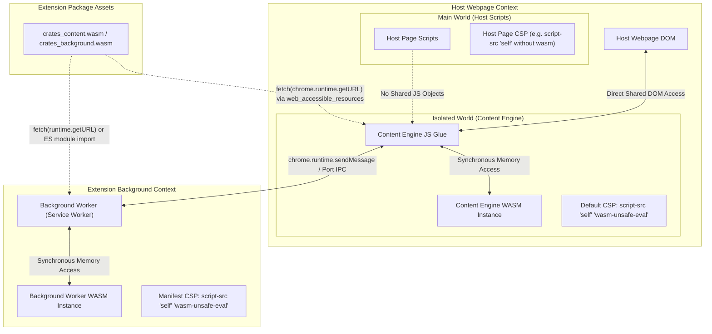

# MV3 WebAssembly Loading and Content Security Policy (CSP) Constraints

**Document Status:** Complete  
**Date:** October 2026  
**Context:** Research Spike for Vimium-RS ([c4kar/vimium-rs#2](https://github.com/c4kar/vimium-rs/issues/2))  
**Target Environments:** Google Chrome (Manifest V3), Mozilla Firefox (Manifest V3)  

---

## 1. Executive Summary

This report establishes the technical architecture and compliance boundaries for bundling, loading, and instantiating WebAssembly (WASM) modules within Manifest V3 (MV3) browser extensions for both Google Chrome and Mozilla Firefox.

### Key Architectural Findings

1. **CSP Relaxation via `'wasm-unsafe-eval'`:** Manifest V3 strictly prohibits evaluating arbitrary JavaScript strings (e.g., `eval()`, `new Function()`) and blocks remote code execution. However, both Chrome and Firefox support the granular `'wasm-unsafe-eval'` CSP directive under `content_security_policy.extension_pages`. This permits the compilation and instantiation of local WebAssembly binaries without introducing JavaScript dynamic code injection vulnerabilities.
2. **Content Engine Execution in Isolated Worlds:** Content scripts running in standard **Isolated Worlds** execute within a browser-managed execution context with a built-in default CSP that permits `'wasm-unsafe-eval'`. They are immune to the host webpage's CSP (e.g., strict policies on GitHub or banking portals). Injecting code into the **Main World** (`world: "MAIN"`) must be avoided because it subjects extension code to the host page's CSP, which frequently forbids WebAssembly execution.
3. **Web-Accessible Resource Declaration:** When loading `.wasm` binaries in the Content Engine via `fetch(chrome.runtime.getURL("..."))`, the binary asset must be declared in `manifest.json` under `web_accessible_resources`. To prevent website fingerprinting (detecting whether Vimium-RS is installed), Chrome MV3's `"use_dynamic_url": true` must be enabled.
4. **Ephemeral Background Worker Lifecycle:** In Chrome, the Background Worker runs as an ephemeral Service Worker that shuts down after ~30 seconds of inactivity. WebAssembly in-memory state does not persist across service worker terminations; therefore, the Background Worker must decouple stateless compute from durable state (stored in `chrome.storage.session` or `chrome.storage.local`) and support fast cold-start re-instantiation.
5. **Store Policy Compliance:**
   - **Chrome Web Store (CWS):** Completely prohibits remotely hosted executable code; all WASM binaries must be packaged locally. Code obfuscation is banned, but standard Rust compilation is permitted.
   - **Mozilla Add-ons (AMO):** Strictly mandates a **Source Code Submission** package alongside the compiled extension archive. Developers must provide the human-readable Rust source tree, exact compiler versions (`rustc`, `wasm-pack`), locked dependency manifests (`Cargo.lock`), and deterministic build instructions so Mozilla reviewers can independently reproduce byte-for-byte or functionally identical `.wasm` binaries.
6. **Recommended Packaging Pipeline:** Compile the Rust crates (`crates/core`, `crates/content`, `crates/background`) with `wasm-pack build --target web` (or `--target bundler`), bundled via **Vite** using `vite-plugin-wasm` and `@crxjs/vite-plugin` (or `@samrum/vite-plugin-web-extension`). Separate `.wasm` assets instantiated via `WebAssembly.instantiateStreaming` deliver the lowest latency and optimal memory overhead compared to Base64 inlining.

---

## 2. Content Security Policy (CSP) in Manifest V3

### 2.1 The Manifest V3 Security Model

Manifest V3 radically changes how browser extensions execute code. Under Manifest V2, developers could loosen the extension CSP to allow `'unsafe-eval'` or fetch remote scripts from external servers. MV3 eliminates this capability:

* **Remote Code Ban:** Extensions cannot download and execute code from outside the extension package. All logic (JavaScript and WebAssembly) must be statically bundled within the extension `.zip` or `.xpi` package.
* **Prohibition of `'unsafe-eval'`:** General string evaluation (`eval()`, `new Function()`, `setTimeout("code", delay)`) is forbidden in the `extension_pages` CSP policy.

### 2.2 The `'wasm-unsafe-eval'` Directive

Because WebAssembly compilation technically uses runtime binary-to-native code generation mechanisms resembling `eval()`, standard CSP `script-src 'self'` blocks `WebAssembly.compile()` and `WebAssembly.instantiate()`.

To solve this without sacrificing XSS defenses, the W3C WebExtensions Community Group and browser vendors standardized the `'wasm-unsafe-eval'` keyword. This keyword relaxes the CSP exclusively for WebAssembly byte compilation while maintaining strict denial of JavaScript string evaluation.

#### Minimum Required Extension CSP (`manifest.json`)
```json
{
  "manifest_version": 3,
  "content_security_policy": {
    "extension_pages": "script-src 'self' 'wasm-unsafe-eval'; object-src 'self';"
  }
}
```

### 2.3 Cross-Browser CSP Differences

| Dimension | Google Chrome MV3 | Mozilla Firefox MV3 |
| :--- | :--- | :--- |
| **Extension Pages CSP** | Explicitly configured via `extension_pages`. Requires `'wasm-unsafe-eval'` for WASM. | Explicitly configured via `extension_pages`. Requires `'wasm-unsafe-eval'` for WASM. |
| **Default Extension Pages CSP** | `script-src 'self'; object-src 'self';` | `script-src 'self'; object-src 'self';` |
| **Background Target** | Service Worker (`service_worker: "background.js"`). | Event Pages / Modular Scripts (`scripts: ["background.js"]`, `type: "module"`). Service workers supported experimentally. |
| **Content Script CSP** | Enforced by browser-managed Isolated World CSP. Includes `'wasm-unsafe-eval'`. | Content scripts run in an expanded-privilege sandbox with Xray vision; extension CSP applies. |
| **Sandbox Context** | `content_security_policy.sandbox` allows `'unsafe-eval'`, but sandboxed pages lose access to `chrome.*` APIs. | Supported via `sandbox` attribute in manifest. |

---

## 3. Execution Contexts: Content Engine vs. Background Worker

The Vimium-RS architecture splits responsibilities between the **Content Engine** (DOM traversal, Hint Marker overlay rendering, and Key Sequence capturing) and the **Background Worker** (cross-tab coordination, window tracking, and privileged WebExtension APIs). These components operate in fundamentally different browser environments with distinct CSP rules.



### 3.1 Content Engine (Content Scripts)

#### Isolated World vs. Main World
Chrome and Firefox execute content scripts in an **Isolated World** by default:
- **Main World (`world: "MAIN"`):** Executes in the identical JavaScript runtime environment as the webpage. Injected scripts are subject to the **Host Webpage's CSP**. If a user visits GitHub, PayPal, or Jira with a strict CSP (`script-src 'self' https:` without `'wasm-unsafe-eval'`), any attempt to instantiate WebAssembly will throw:
  ```text
  EvalError: Refused to compile or instantiate WebAssembly module because 'wasm-unsafe-eval' is not an allowed source of script in the following Content Security Policy directive...
  ```
- **Isolated World (`world: "ISOLATED"`):** The Content Engine shares the page's DOM tree but maintains an isolated JavaScript global scope (`window`). Crucially, Chromium enforces a dedicated **isolated world CSP**:
  ```http
  script-src 'self' 'wasm-unsafe-eval' 'inline-speculation-rules' chrome-extension://<extension-id>/; object-src 'self';
  ```
  Because `'wasm-unsafe-eval'` is part of the isolated world's baseline policy, the Content Engine can compile and instantiate WebAssembly directly, regardless of how strict the host website's CSP is.

#### Web-Accessible Resources and Anti-Fingerprinting
To load the `.wasm` file into the Content Engine, it must be fetched via `chrome.runtime.getURL()`. Chromium treats this as a cross-origin resource request relative to the host page origin, requiring the file to be listed in `web_accessible_resources`.

*Fingerprinting Risk:* If an extension declares static resources accessible to `<all_urls>`, any webpage script can test `fetch("chrome-extension://<id>/content_bg.wasm")` to fingerprint the user's installed extensions.

*Solution (`use_dynamic_url`):* Chrome MV3 introduces dynamic, per-session tokens for web-accessible resources:
```json
{
  "web_accessible_resources": [
    {
      "resources": ["assets/content_engine_bg.wasm"],
      "matches": ["<all_urls>"],
      "use_dynamic_url": true
    }
  ]
}
```
When `use_dynamic_url: true` is configured, Chrome issues a unique, rotating GUID for the resource per browser session, preventing host pages from detecting the extension ID. In Firefox, extension UUIDs are already randomly generated per user profile by default.

### 3.2 Background Worker (Extension Service Worker)

In Chrome MV3, the Background Worker runs in a WebExtension Service Worker, whereas Firefox MV3 supports both background event pages and service workers.

#### Constraints of Extension Service Workers
1. **No DOM / Window APIs:** The Service Worker environment lacks `document`, `window`, and `HTMLElement`. The Core Engine running in the Background Worker must strictly consume serialized data or raw messages.
2. **Ephemeral Lifecycle (Cold Shutdowns):** Chrome terminates idle Service Workers after ~30 seconds of inactivity. When the user later enters a Key Sequence or switches tabs, Chrome spins up a fresh Service Worker process.
3. **WASM Re-instantiation Latency:** Because process termination discards the V8 heap, in-memory WASM linear memory and tables are cleared. Upon reactivation, the WASM binary must be re-instantiated. 
   - *Mitigation:* Ensure the `.wasm` module is pre-compiled and instantiated during the top-level Service Worker initialization. Using `WebAssembly.instantiateStreaming` against the local package cache ensures re-instantiation occurs within 3–8 ms.
4. **State Persistence:** Any state managed by the Rust Core Engine in the background (e.g., jump marks, custom key sequence mappings, exclusion rules) must be serialized to `chrome.storage.session` (in-memory persistent across SW restarts) or `chrome.storage.local`.

---

## 4. WebAssembly Instantiation Mechanics

### 4.1 Instantiation API Comparison

There are two primary WebAssembly instantiation APIs on the modern web platform:

#### 1. `WebAssembly.instantiateStreaming` (Recommended)
Streams the bytecode directly to the browser's underlying engine (V8 / SpiderMonkey) while fetching, compiling bytes incrementally as they arrive:
```javascript
const wasmUrl = chrome.runtime.getURL("assets/content_engine_bg.wasm");
const response = await fetch(wasmUrl);
const { instance, module } = await WebAssembly.instantiateStreaming(response, imports);
```
- **Prerequisite:** Requires the HTTP response header `Content-Type: application/wasm`. Both Chrome (`chrome-extension://`) and Firefox (`moz-extension://`) package protocols return `Content-Type: application/wasm` automatically when serving `.wasm` files from the bundle.
- **Performance:** Lowest peak heap allocation; compilation overlaps with I/O.

#### 2. `WebAssembly.instantiate` (Buffer Fallback)
Buffers the complete binary into memory as an `ArrayBuffer` before invoking the compiler:
```javascript
const wasmUrl = chrome.runtime.getURL("assets/content_engine_bg.wasm");
const response = await fetch(wasmUrl);
const bytes = await response.arrayBuffer();
const { instance, module } = await WebAssembly.instantiate(bytes, imports);
```
- **Fallback Purpose:** Used if `instantiateStreaming` fails or in environments where streaming compilation encounters streaming MIME restrictions.

### 4.2 Loading Strategies: External Asset vs. Base64 Inlining

| Feature | External `.wasm` File (`fetch` + Streaming) | Inlined Base64 in JavaScript Bundle |
| :--- | :--- | :--- |
| **Instantiator** | `WebAssembly.instantiateStreaming(fetch(...))` | `WebAssembly.instantiate(Uint8Array.from(atob(...)))` |
| **Bundle Size** | Optimal (native binary size, ~100–300 KB). | +33% size penalty due to Base64 encoding. |
| **Startup Latency** | Asynchronous, fast pipelined compilation. | Synchronous decode overhead; blocks thread on large binaries. |
| **Memory Footprint** | Low peak memory; compiled directly from stream. | Double memory: base64 string + typed array + compiled code. |
| **`manifest.json` Needs** | Requires `web_accessible_resources`. | No `web_accessible_resources` needed. |
| **Host Fingerprinting** | Mitigated via `use_dynamic_url: true`. | Completely immune to resource probing. |
| **Recommendation** | **Primary choice for Vimium-RS.** | Viable only for micro-modules (<50 KB). |

---

## 5. Web Store Review and Compliance Policies

Both the Chrome Web Store and Mozilla Add-on store enforce strict automated and human audits on extensions containing binary assets. Non-compliance results in immediate store rejection.

### 5.1 Chrome Web Store (CWS) Policies

1. **Remote Code Execution Ban (Section: Developer Program Policies):**
   - Extensions must not download, parse, or execute remote executable code. Any `.wasm` binary loaded dynamically from a CDN or remote server will cause an immediate ban. All `.wasm` files must be included in the submission zip archive.
2. **Code Quality and Anti-Obfuscation:**
   - CWS explicitly forbids obfuscated code. While compiled WebAssembly is recognized as a legitimate binary format and is not considered obfuscated JS per se, Google's automated scanners inspect the companion JavaScript glue code generated by `wasm-bindgen`.
   - *Requirement:* The accompanying JS wrapper code must be cleanly formatted and non-obfuscated. Variable names produced by standard bundlers (minification) are permitted, but commercial JS obfuscators are strictly forbidden.
3. **Transparency and Auditability:**
   - For extensions containing complex Rust WASM binaries, Google reviewers may request documentation or access to the public repository during review to verify the legitimacy of low-level memory operations.

### 5.2 Mozilla Add-ons (AMO) Policies

Mozilla's Add-on Policies are significantly more demanding regarding compiled binaries than Google's:

1. **Mandatory Source Code Submission:**
   - Any extension submitted to AMO containing compiled code (WebAssembly from Rust/C++) or machine-generated scripts **must** provide a separate **Source Code Package** in the Developer Hub during upload.
2. **Reproducible Build Verification:**
   - Mozilla human reviewers will download the source package, execute the provided build script, and compare the generated `.wasm` binary against the `.wasm` file included in the submitted `.xpi`.
   - The submission package must include:
     - Complete Rust source tree (`Cargo.toml`, `Cargo.lock`, `crates/core`, `crates/content`, etc.).
     - Exact pinned toolchain versions (`rustc` version, `wasm-pack` version, Node.js version).
     - A clear `README.md` containing single-command reproduction instructions (e.g., `make build` or `npm run build`).
     - A deterministic Docker build configuration (recommended) to eliminate environmental discrepancies (such as host OS path differences or build timestamp hashes).

---

## 6. Practical Packaging Patterns: `wasm-pack` + Vite

### 6.1 `wasm-pack` Target Selection

`wasm-pack` provides multiple output targets via the `--target` flag:

| Target | Generated Output | Suitability for MV3 |
| :--- | :--- | :--- |
| `--target web` | Exports an `init()` ES function that accepts a URL, Request, or buffer. Defaults to `import.meta.url`. | **Recommended:** Highly flexible, allows passing explicit `chrome.runtime.getURL()` to `init()`. |
| `--target bundler` | Emits `import * as wasm from './module_bg.wasm'`. Relies on bundler plugin hooks. | **Recommended with Vite:** Works seamlessly when paired with `vite-plugin-wasm`. |
| `--target nodejs` | Uses Node `require()` and `fs`. | Incompatible with browser extensions. |
| `--target no-modules` | Emits a global `wasm_bindgen` function. | Legacy, discouraged for modern ES builds. |

### 6.2 Recommended Bundler Architecture (Vite + `vite-plugin-wasm`)

Vite is the modern standard for fast bundling and TypeScript integration in WebExtensions. The following setup demonstrates a unified build configuration for Vimium-RS.

#### 1. Manifest Configuration (`manifest.json`)
```json
{
  "manifest_version": 3,
  "name": "Vimium-RS",
  "version": "0.1.0",
  "description": "Keyboard-driven navigation rewritten in Rust and WebAssembly.",
  "permissions": [
    "storage",
    "tabs",
    "activeTab"
  ],
  "content_security_policy": {
    "extension_pages": "script-src 'self' 'wasm-unsafe-eval'; object-src 'self';"
  },
  "background": {
    "service_worker": "dist/background/index.js",
    "type": "module"
  },
  "content_scripts": [
    {
      "matches": ["<all_urls>"],
      "js": ["dist/content/index.js"],
      "run_at": "document_start"
    }
  ],
  "web_accessible_resources": [
    {
      "resources": ["assets/*.wasm"],
      "matches": ["<all_urls>"],
      "use_dynamic_url": true
    }
  ]
}
```

#### 2. Vite Build Configuration (`vite.config.ts`)
```typescript
import { defineConfig } from 'vite';
import wasm from 'vite-plugin-wasm';
import topLevelAwait from 'vite-plugin-top-level-await';
import { resolve } from 'path';

export default defineConfig({
  plugins: [
    wasm(),
    topLevelAwait()
  ],
  build: {
    target: 'esnext',
    outDir: 'dist',
    rollupOptions: {
      input: {
        background: resolve(__dirname, 'src/background/index.ts'),
        content: resolve(__dirname, 'src/content/index.ts')
      },
      output: {
        entryFileNames: '[name]/index.js',
        chunkFileNames: 'chunks/[name]-[hash].js',
        assetFileNames: 'assets/[name].[ext]'
      }
    }
  }
});
```

#### 3. Content Engine WASM Loader (`src/content/wasm_loader.ts`)
```typescript
import init, { init_content_engine } from '../../crates/content/pkg/content_engine.js';

let isInitialized = false;

export async function bootstrapContentEngine(): Promise<void> {
  if (isInitialized) return;

  try {
    // Resolve dynamic extension package URL
    const wasmUrl = chrome.runtime.getURL('assets/content_engine_bg.wasm');

    // Attempt streaming instantiation first
    try {
      const response = await fetch(wasmUrl);
      await init(response);
    } catch (streamingErr) {
      console.warn('WASM streaming instantiation failed, falling back to arrayBuffer:', streamingErr);
      const fallbackResponse = await fetch(wasmUrl);
      const buffer = await fallbackResponse.arrayBuffer();
      await init(buffer);
    }

    // Initialize Rust Content Engine DOM listeners and state
    init_content_engine();
    isInitialized = true;
    console.debug('Vimium-RS Content Engine initialized successfully.');
  } catch (error) {
    console.error('Critical failure: unable to bootstrap Content Engine WASM:', error);
  }
}
```

#### 4. Background Worker WASM Loader (`src/background/wasm_loader.ts`)
```typescript
import init, { init_background_worker } from '../../crates/background/pkg/background_worker.js';

let isWorkerInitialized = false;

export async function bootstrapBackgroundWorker(): Promise<void> {
  if (isWorkerInitialized) return;

  try {
    // In service workers, self.location or chrome.runtime.getURL resolves package paths
    const wasmUrl = chrome.runtime.getURL('assets/background_worker_bg.wasm');
    const response = await fetch(wasmUrl);
    await init(response);

    init_background_worker();
    isWorkerInitialized = true;
    console.debug('Vimium-RS Background Worker initialized successfully.');
  } catch (err) {
    console.error('Failed to initialize Background Worker WASM:', err);
  }
}
```

---

## 7. Architectural Decisions for Vimium-RS

Based on the research findings, the following architectural decisions are established:

1. **Dual WASM Boundaries:**
   - **Content Engine (`crates/content`):** Compiles to a small, fast-loading `.wasm` module. Runs strictly in the **Isolated World** to maintain complete immunity from host webpage CSP restrictions. It instantiates the WASM module asynchronously during `document_start` to minimize latency before first key capture.
   - **Background Worker (`crates/background`):** Compiles to a separate `.wasm` binary that handles tab management, persistent configuration, and global state machines. It is loaded in the extension Service Worker (Chrome) or Background Script (Firefox).
   - **Core Engine (`crates/core`):** Pure Rust library dependency shared by both `crates/content` and `crates/background`, without direct browser API dependencies, enabling rapid headless native unit testing (`cargo test`).
2. **CSP Manifest Directive:**
   - `content_security_policy.extension_pages` must specify `"script-src 'self' 'wasm-unsafe-eval'; object-src 'self';"`.
3. **Web-Accessible Resource Safety:**
   - Declare `.wasm` binaries under `web_accessible_resources` with `"use_dynamic_url": true` to protect user privacy against website tracking.
4. **Reproducible Release Pipeline for AMO:**
   - The CI release pipeline must include a Dockerized build target generating both the `.zip` / `.xpi` distribution archives and the source submission archive (`vimium-rs-source.tar.gz`) containing locked dependencies and build scripts to guarantee instant compliance with Mozilla AMO reviewers.

---

## 8. Primary Sources & Citations

1. **W3C WebExtensions Community Group:**
   - [Content Security Policy in WebExtensions Specification](https://w3c.github.io/webextensions/csp.html)
2. **Google Chrome Developers:**
   - [Manifest V3 Content Security Policy Guide](https://developer.chrome.com/docs/extensions/reference/manifest/content-security-policy)
   - [Web-Accessible Resources in MV3](https://developer.chrome.com/docs/extensions/reference/manifest/web-accessible-resources)
   - [Using WebAssembly in Manifest V3](https://developer.chrome.com/docs/extensions/develop/concepts/content-scripts)
   - [Chrome Web Store Developer Program Policies: Code Quality and Obfuscation](https://developer.chrome.com/docs/webstore/program-policies/code-quality)
3. **Mozilla Developer Network (MDN) & Extension Workshop:**
   - [MDN: Manifest V3 in Firefox](https://developer.mozilla.org/en-US/docs/Mozilla/Add-ons/WebExtensions/manifest.json/content_security_policy)
   - [Firefox Extension Workshop: Source Code Submission Requirements](https://extensionworkshop.com/documentation/publish/source-code-submission/)
   - [MDN: WebAssembly JavaScript Interface](https://developer.mozilla.org/en-US/docs/WebAssembly/JavaScript_interface)
4. **Chromium Issue Tracker:**
   - [Issue 40746118: WebAssembly execution in MV3 extensions](https://issues.chromium.org/issues/40746118)
   - [Issue 41450810: Implementation of 'wasm-unsafe-eval' CSP directive](https://issues.chromium.org/issues/41450810)
