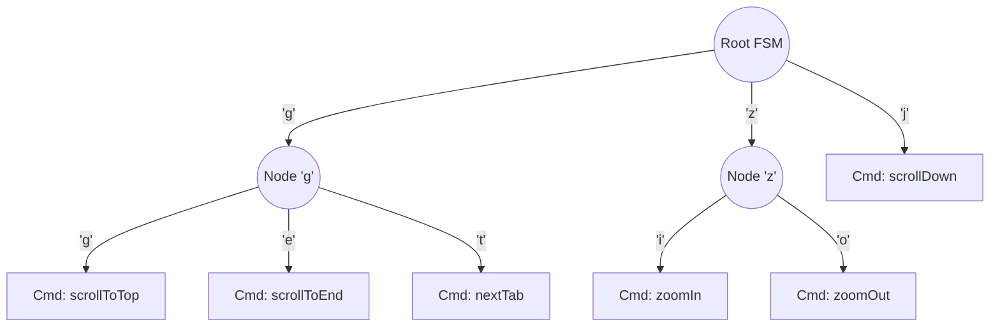
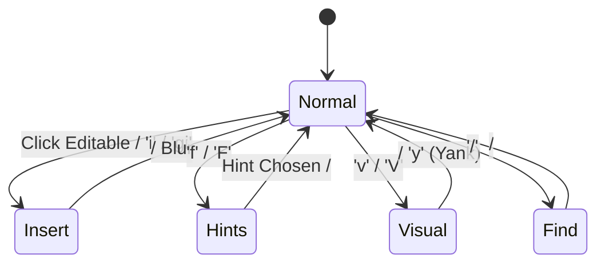

# Vimium C Link Hinting and Key Engine Algorithmic Analysis

## Executive Summary

This document provides a comprehensive algorithmic analysis of Vimium C's core navigation subsystems—specifically **Link Hint Generation & Positioning** and the **Key Sequence Engine & Modal State Machine**—alongside a comparative study of `smllb/qhints-rs`. The goal is to design clean, idiomatic, and zero-allocation Rust data structures and algorithms for `crates/core` in `vimium-rs`.

A foundational architectural requirement for `vimium-rs` is the strict decoupling of pure computation from browser DOM APIs:
- **`crates/core`**: Implements prefix-free tree math, radix tries, 2D rectangular box geometry, and finite state machines (FSM) in pure, platform-agnostic Rust with zero external DOM dependencies and zero heap allocations in steady-state dispatch.
- **`crates/content`**: Gathers DOM element geometry, queries interactive targets, and renders/offsets visual badges based on output from `crates/core`.

---

## 1. Link Hint Generation & Prefix-Free Tree Construction

### 1.1 The Mathematical Problem

Given:
- An alphabet $\Sigma$ of size $M = |\Sigma|$ (default Vimium C alphabet: `sadfjklewcmpgh`, $M = 14$; or 10-key numbers `0123456789`, $M = 10$).
- A collection of $N$ visible, clickable interactive elements.

We must assign each element a unique label string $L_i \in \Sigma^*$ such that:
1. **Prefix-Free Property (Instant Decodability)**: No assigned hint label $L_i$ is a prefix of any other assigned hint label $L_j$ ($i \neq j$).
2. **Minimal Average Length**: The tree depth is minimized so users execute the fewest keystrokes possible.
3. **Short-Hint Favoring**: If $N \le M$, all hints must have length 1. If $N > M$, hints should partition into short (length $k$) and longer (length $k+1$) strings, rather than padding all hints to uniform maximum length.
4. **Deterministic Ordering**: Hint labels must map predictably across the screen (alphabetical reading order).

### 1.2 Vimium C's Bit-Packed $M$-ary Tree Algorithm

In `content/hint_filters.ts` (`initAlphabetEngine`), Vimium C implements an optimal $M$-ary tree partition using compact bit-packing into integer arrays:

```typescript
export const initAlphabetEngine = (hintItems: readonly HintItem[]): void => {
  const step = hintChars.length, chars2 = " " + hintChars,
  count = hintItems.length,
  start = (math.ceil((count - 1) / (step - 1)) | 0) || 1,
  bitStep = math.ceil(math.log2(step + 1)) | 0;
  let hints: number[] = [0], next = 1, bitOffset = 0;
  for (let offset = 0, hint = 0; offset < start; ) {
    if (next === offset) { next = next * step + 1, bitOffset += bitStep; }
    hint = hints[offset++];
    for (let ch = 1; ch <= step; ch++) { hints.push((ch << bitOffset) | hint); }
  }
  maxPrefixLen_ = (bitOffset / bitStep - +(next > start)) | 0;
  while (next-- > start) { hints[next] <<= bitStep; }
  hints = hints.slice(start, start + count).sort((i, j) => i - j);
  for (let i = 0, mask = (1 << bitStep) - 1; i < count; i++) {
    let hintString = "", num = hints[i];
    if (!(num & mask)) { num >>= bitStep; }
    for (; num; num >>>= bitStep) {
      hintString += chars2[num & mask];
    }
    hintItems[i].a = hintString;
  }
}
```

#### Step-by-Step Algorithmic Derivation

1. **Tree Expansion Arithmetic**:
   - In a full $M$-ary tree, every time an internal node is expanded, it is replaced by $M$ child nodes. The net increase in total available leaves is $M - 1$.
   - Starting from 1 root leaf, to generate $N$ terminal leaves, the number of internal nodes that must be expanded is:
     $$\text{start} = \max\left(1, \left\lceil \frac{N - 1}{M - 1} \right\rceil\right)$$
   - Expanding exactly `start` nodes creates $1 + \text{start} \cdot (M - 1) \ge N$ leaves.
   - The nodes indexed $0 \dots (\text{start}-1)$ become **internal nodes**, while nodes indexed $\text{start} \dots (\text{start} + N - 1)$ become **terminal leaves**.
   - By definition, no leaf node is an ancestor or prefix of any other leaf node.

2. **Bit-Packed Breadth-First Expansion**:
   - Instead of allocating tree node objects or heap strings, characters are encoded as 1-based integers ($1 \le c \le M$).
   - Each character occupies $\text{bitStep} = \lceil \log_2(M + 1) \rceil$ bits (e.g. For $M=14$, $\text{bitStep} = \lceil \log_2(15) \rceil = 4$ bits).
   - Node identifiers are packed bitwise:
     $$\text{child} = (ch \ll \text{bitOffset}) \mid \text{parent}$$
     This appends character $ch$ as the most significant bit chunk while preserving the parent prefix in the lower bits.

3. **Depth Alignment and Lexicographical Sort**:
   - Shorter branches (depth $k$) are aligned to depth $k+1$ by left-shifting remaining nodes: `hints[next] <<= bitStep`.
   - The slice `hints[start .. start + count]` is sorted numerically, which directly corresponds to lexicographical order of the alphabet $\Sigma$.

4. **Decoding to Strings**:
   - Each integer is decoded in chunks of $\text{bitStep}$ bits using bitwise masking: `chars2[num & mask]`, followed by `num >>>= bitStep`.

---

## 2. Hint Marker Geometry, Viewport Clipping & Collision Resolution

Element detection on dynamic web pages requires handling overlapping bounding rects, nested elements, sticky/fixed navigation bars, and iframe boundaries.

### 2.1 Viewport Clipping & ViewBox Computation

In `content/local_links.ts` and `lib/rect.ts`:
- Elements are cropped to the visible viewport:
  $$\text{VisibleRect} = \text{ElementRect} \cap \text{ViewportBox}$$
- If $\text{VisibleRect}.\text{width} < 3\text{px}$ or $\text{VisibleRect}.\text{height} < 3\text{px}$, the element is discarded as invisible or sub-pixel artifact.
- Markers placed near the right or bottom viewport edge are clamped:
  $$\text{st.maxWidth} = \max(0, \text{ViewportRight} - \text{markerLeft})$$
  This prevents badges from triggering browser scrollbars or overflowing outside window bounds.

### 2.2 Boolean 2D Box Subtraction (`subtractSequence`)

When multiple clickable DOM elements overlap (e.g. an `<a>` inside a `<div>` or a floating close button over a link banner), Vimium C computes the Boolean rectangular difference ($R_1 \setminus R_2$):

```
       +-----------------------+
       |         Top           |
+------+-----------------------+------+
| Left |     Overlap (R2)      | Right|
+------+-----------------------+------+
|        Bottom                |
+------------------------------+
```

When $R_1 = [x_0, y_0, x_3, y_3]$ intersects $R_2 = [x_1, y_1, x_2, y_2]$, $R_1 \setminus R_2$ is decomposed into up to 4 non-overlapping orthogonal rectangles:
1. **Left Sliver**: $[x_0, y_0, x_1, y_3]$ (if $x_0 < x_1$)
2. **Top Sliver**: $[x_1, y_0, x_3, y_1]$ (if $y_0 < y_1$)
3. **Bottom Sliver**: $[x_1, y_2, x_3, y_3]$ (if $y_2 < y_3$)
4. **Right Sliver**: $[x_2, y_1, x_3, y_2]$ (if $x_2 < x_3$)

If $R_1 \setminus R_2 = \emptyset$ (i.e. $R_1$ is completely obscured by $R_2$):
- If $R_1$ is a "weak click target" (e.g. generic listener on a wrapper) and $R_2$ is a child target, $R_1$ is discarded (`splice`).
- Otherwise, $R_1$ is marked for coordinate collision offsetting.

#### Sliding Window Optimization ($O(N)$ vs $O(N^2)$)
Instead of checking all pairs ($O(N^2)$), Vimium C iterates elements in reverse DOM order and checks overlaps only within a **sliding window of the preceding 16 elements** (`_j = max(0, len - 16)`):
- Local DOM nodes are spatially clustered in markup.
- Bounding the check to 16 items reduces geometric clipping to linear time $O(16 \cdot N) = O(N)$, ensuring sub-millisecond execution even with 1,000+ candidate elements.

### 2.3 Marker Collision Stacking and Horizontal Offsetting

If two hint markers would be positioned within close proximity:
$$\Delta x < 10\text{px} \quad \text{and} \quad \Delta y < 8\text{px}$$
Vimium C prevents unreadable badge collisions by applying a staggered horizontal offset:
$$\text{markerLeft}_{\text{new}} = \text{markerLeft}_{\text{original}} + 13\text{px}$$
Subsequent colliding badges on the same spot shift successively by $+13\text{px}, +26\text{px}, \dots$.

### 2.4 Z-Index Cycling via Connected Components (`rotate1`)

When hint markers still overlap:
1. Marker bounding boxes are tested for intersection.
2. Intersecting markers are partitioned into connected components (disjoint stacks) using a Union-Find / stack clustering algorithm.
3. Colliding stacks (length $> 1$) are registered.
4. When the user presses `Space`, `Shift-Tab`, or a rotate key, the z-indexes within each stack are cyclically shifted:
   $$\text{zIndex}[j] \leftarrow \text{zIndex}[(j + 1) \pmod K]$$
5. CSS classes `SH` (showing) and `OH` (overlapped) are toggled so the newly uncovered badge becomes readable.

### 2.5 Reachability Testing (`elementsFromPoint`)

To ensure elements are not hidden behind fixed headers, overlays, or modal backdrops:
- Center coordinate $(c_x, c_y)$ is checked via `root.elementFromPoint(cx, cy)`.
- If obscured, a 4-corner offset check is attempted:
  - $(c_x, \text{top} + 2)$, $(c_x, \text{bottom} - 4)$, $(\text{left} + 2, c_y)$, $(\text{right} - 4, c_y)$.
- Time budget protection: Capped at a strict execution deadline (default 30ms, sampled every 64 iterations `i & 63 == 0`) to prevent main thread frame-drops on complex single-page apps.

---

## 3. Comparative Analysis: `smllb/qhints-rs` vs Vimium C

`smllb/qhints-rs` is a native Rust desktop hint overlay tool (operating over X11 / AT-SPI / OCR). Analyzing its implementation provides key insights into Rust-native hint architectures:

| Architectural Dimension | Vimium C (`link_hints.ts`) | `smllb/qhints-rs` (`hints.rs`, `filter.rs`) | Recommendation for `vimium-rs` |
| :--- | :--- | :--- | :--- |
| **Label Space Partitioning** | Global prefix-free $M$-ary tree. Single-key hints assigned to top elements; double/triple keys as needed. | Spatial zone bucketing. Screen is divided into rows/cols mapped to keyboard physical keys; overflow spills to neighbors. | **Adopt Vimium C's Prefix-Free Engine** for browser navigation; spatial grid creates rigid, long keys on dense link lists. |
| **Overlap Detection** | Local sliding-window (16 elements) Boolean box subtraction ($R_1 \setminus R_2$) + horizontal $+13\text{px}$ offset. | Pairwise $O(N^2)$ intersection over area: `inter / min_area > threshold`. Culled if smaller. | **Adopt Vimium C's Sliding-Window Subtraction** in `crates/core` with stack-allocated `SmallVec<[Rect; 4]>`. |
| **Z-Index Handling** | Disjoint-set collision stacks with interactive z-index rotation (`rotate1`). | Complete culling: smaller or non-text child is dropped (`cull_overlaps`). | **Adopt Disjoint-Set Z-Index Rotation** for clickable targets that cannot be culled without losing user access. |
| **Data Representation** | Dynamic JS objects with DOM element references. | Owned `struct Child { relative_position, width, height, kind }`. | **Adopt Flat Rust Structs** (`ElementRect`, `HintDescriptor`) with numeric entity IDs (`ElementId(u32)`). |

---

## 4. Key Sequence Engine & Modal State Machine

### 4.1 Key Canonicalization Pipeline

Every keyboard event is normalized into a canonical string format:
1. Modifiers sorted and prefixed: `<a-c-m-s-key>` (`a` = Alt, `c` = Control, `m` = Meta/Command, `s` = Shift).
2. ASCII / layout normalization: Mapping non-ASCII layouts or localized keys to standard characters.
3. Canonical representation examples:
   - Plain lowercase: `j`, `k`, `g`
   - Single uppercase: `G`, `H`
   - With modifiers: `<c-f>`, `<m-s-p>`, `<a-j>`
   - Special keys: `<Enter>`, `<Esc>`, `<Backspace>`, `<Tab>`, `<F1>`

### 4.2 Count Prefixes (`10j`, `3<c-d>`)

- Digits `0-9` (and `-` for negative counts) act as prefix multipliers in Normal mode.
- In `populateKeyMap_`:
  ```typescript
  ref.set("-", KeyAction.count);
  for (let num = 0; num <= 9; num++) { ref.set("" + num, KeyAction.count); }
  ```
- **State Transition Rule**:
  - If state machine is at root and a digit is received, transition action is `KeyAction.count`.
  - The digit is appended to a count accumulator: $\text{count} \leftarrow \text{count} \times 10 + d$.
  - State machine remains at root (`nextKeys = keyFSM`).
  - When a non-digit command key arrives (e.g. `j`), the accumulated count is passed to the command handler: `executeCommand(cmd, count)`.
  - Leading zero (`0`) without prior digits triggers the `scrollToLeft` command rather than a count prefix.

### 4.3 Multi-Key Mappings as a Radix / Prefix Trie

Multi-key sequences (`gg`, `zi`, `yt`, `cs`) are structured as a prefix tree (Trie / FSM):



- **Prefix State**: When `g` is pressed, `nextKeys` points to the child trie node `G_Node`. Input event is intercepted and prevented from reaching the browser.
- **Match Leaf**: When second key `g` is pressed, `KeyAction.cmd` triggers `scrollToTop`. FSM resets to root.
- **Sequence Timeout**: If no subsequent key arrives within `KeySequenceTimeout` (default 1000ms), the partial sequence expires and the FSM resets to root.
- **Explicit Cancellation**: Pressing `<Esc>` or `<C-[>` resets partial matches immediately.

### 4.4 URL Exclusion Rules & Pass-Keys

Exclusion rules determine whether keystrokes pass directly to the webpage:
1. **Rule Storage**: URL matchers supporting:
   - `kMatchUrl.StringPrefix`: e.g. `https://github.com/`
   - `kMatchUrl.RegExp`: e.g. `^https?://.*\.slack\.com/`
   - `kMatchUrl.Pattern`: Declarative `URLPattern` matching.
2. **Pass-Key Specification**:
   - `""` (Empty string): Vimium C is disabled completely on the matching URL.
   - `"^"`: Pass all keys to the page (full passthrough).
   - `"j k <c-e>"`: Selective passthrough. Keys listed in `passKeys` bypass Vimium C; all unlisted keys are captured and processed.
3. **`passNextKey` (Temporary Interception Override)**:
   - Command: `passNextKey [count=1]`.
   - Installs a high-priority event filter:
     - Non-repeating keydown events decrement the pass counter.
     - Keystrokes pass natively through to the DOM (`HandlerResult.Nothing`).
     - Once counter reaches zero, the handler removes itself and Normal mode resumes.
     - Supports `normal: true` option: Inverts behavior to temporarily grant 1 Normal mode command on an excluded page.

### 4.5 Modal State Machine

Vimium C maintains distinct modal states:



#### Modal Characteristics:
1. **Normal Mode**:
   - Captures all keystrokes against `KeyFSM`.
   - Dispatches single-key, multi-key, and count-prefixed commands.
2. **Insert Mode**:
   - Triggered on DOM `focusin` on `<input>`, `<textarea>`, or elements with `contenteditable="true"`.
   - Keystrokes pass directly to DOM text editing.
   - Escape interceptor: Only `<Esc>` or `<C-[>` are captured to trigger `blur()` and return to Normal mode.
   - Shadow DOM tracking: Pierces shadow roots to identify active editable elements inside Web Components.
3. **Visual Mode**:
   - Sub-modes: `Caret` (cursor movement without selection), `Visual` (character selection), `VisualLine` (line-wise selection).
   - Navigation keys (`h`, `j`, `k`, `l`, `w`, `b`, `0`, `$`) manipulate `window.getSelection()`.
   - Action keys (`y` yank, `p` paste, `c` change) exit back to Normal or Insert mode.
4. **Find Mode**:
   - Displays floating HUD search input.
   - Key strokes update query string in real-time, executing `window.find()` or custom highlight range matching.
   - `n` / `N` cycle forward and backward through search results.
5. **Hints Mode**:
   - Content script enters exclusive capture mode.
   - Keystrokes filter active hint markers using the prefix-free matching engine.

---

## 5. Idiomatic Rust Architecture for `crates/core`

To achieve maximal performance, zero garbage collection pauses, and platform independence, all algorithmic models are designed for `crates/core` using pure Rust.

### 5.1 Prefix-Free Hint Generator (`crates/core/src/hints/`)

```rust
pub const MAX_HINT_LEN: usize = 4;

#[derive(Clone, Copy, PartialEq, Eq, Hash, Debug)]
pub struct HintLabel {
    bytes: [u8; MAX_HINT_LEN],
    len: u8,
}

impl HintLabel {
    pub fn as_str(&self) -> &str {
        std::str::from_utf8(&self.bytes[..self.len as usize]).unwrap_or("")
    }
}

pub struct HintGenerator<'a> {
    alphabet: &'a [u8],
}

impl<'a> HintGenerator<'a> {
    pub fn new(alphabet: &'a [u8]) -> Self {
        assert!(alphabet.len() >= 2 && alphabet.len() <= 64);
        Self { alphabet }
    }

    /// Generate N prefix-free hint labels into a pre-allocated vector.
    pub fn generate_hints(&self, count: usize, out: &mut Vec<HintLabel>) {
        out.clear();
        if count == 0 {
            return;
        }

        let m = self.alphabet.len();
        if count <= m {
            for &ch in &self.alphabet[..count] {
                out.push(HintLabel { bytes: [ch, 0, 0, 0], len: 1 });
            }
            return;
        }

        // Tree arithmetic: start = ceil((count - 1) / (m - 1))
        let start = ((count - 1) + (m - 2)) / (m - 1);
        let bit_step = ((m + 1) as f64).log2().ceil() as usize;

        let mut nodes: Vec<u32> = Vec::with_capacity(start * m + 1);
        nodes.push(0);

        let mut next = 1;
        let mut bit_offset = 0;
        let mut offset = 0;

        while offset < start {
            if next == offset {
                next = next * m + 1;
                bit_offset += bit_step;
            }
            let parent = nodes[offset];
            offset += 1;
            for ch_idx in 1..=m {
                nodes.push(((ch_idx as u32) << bit_offset) | parent);
            }
        }

        // Align unexpanded leaves
        while next > start {
            next -= 1;
            nodes[next] <<= bit_step;
        }

        let leaves = &mut nodes[start..start + count];
        leaves.sort_unstable();

        let mask = (1u32 << bit_step) - 1;
        for &num in leaves.iter() {
            let mut val = num;
            if (val & mask) == 0 {
                val >>= bit_step;
            }
            let mut label = HintLabel { bytes: [0; MAX_HINT_LEN], len: 0 };
            while val > 0 && (label.len as usize) < MAX_HINT_LEN {
                let idx = (val & mask) as usize;
                label.bytes[label.len as usize] = self.alphabet[idx - 1];
                label.len += 1;
                val >>= bit_step;
            }
            out.push(label);
        }
    }
}
```

### 5.2 2D Box Geometry & Sliding Window Culling (`crates/core/src/geo/`)

```rust
use smallvec::SmallVec;

#[derive(Clone, Copy, Debug, PartialEq)]
pub struct Rect {
    pub left: f32,
    pub top: f32,
    pub right: f32,
    pub bottom: f32,
}

impl Rect {
    #[inline]
    pub fn intersects(&self, other: &Rect) -> bool {
        self.right > other.left && self.left < other.right 
            && self.bottom > other.top && self.top < other.bottom
    }

    #[inline]
    pub fn area(&self) -> f32 {
        ((self.right - self.left).max(0.0)) * ((self.bottom - self.top).max(0.0))
    }

    /// Exact 2D box subtraction: self \ other
    /// Yields up to 4 non-overlapping orthogonal rectangles.
    pub fn subtract(&self, other: &Rect) -> SmallVec<[Rect; 4]> {
        let mut result = SmallVec::new();
        if !self.intersects(other) {
            result.push(*self);
            return result;
        }

        let x1 = self.left.max(other.left);
        let x2 = self.right.min(other.right);
        let y1 = self.top.max(other.top);
        let y2 = self.bottom.min(other.bottom);

        // Left sliver
        if self.left < x1 {
            result.push(Rect { left: self.left, top: self.top, right: x1, bottom: self.bottom });
        }
        // Top sliver
        if self.top < y1 {
            result.push(Rect { left: x1, top: self.top, right: self.right, bottom: y1 });
        }
        // Bottom sliver
        if y2 < self.bottom {
            result.push(Rect { left: x1, top: y2, right: self.right, bottom: self.bottom });
        }
        // Right sliver
        if x2 < self.right {
            result.push(Rect { left: x2, top: y1, right: self.right, bottom: y2 });
        }

        result
    }
}

pub struct ElementCandidate {
    pub id: u32,
    pub rect: Rect,
    pub marker_pos: (f32, f32),
    pub is_weak: bool,
}

/// O(W * N) sliding-window overlap subtraction and badge collision offsetting.
pub fn resolve_marker_collisions(
    elements: &mut Vec<ElementCandidate>,
    window_size: usize,
) {
    let len = elements.len();
    if len == 0 {
        return;
    }

    for i in (0..len).rev() {
        let min_j = i.saturating_sub(window_size);
        let mut cur_rect = elements[i].rect;
        let mut fully_obscured = false;

        for j in (min_j..i).rev() {
            let other = elements[j].rect;
            if cur_rect.intersects(&other) {
                let diff = cur_rect.subtract(&other);
                if diff.is_empty() {
                    fully_obscured = true;
                    break;
                }
                cur_rect = diff[0]; // Retain dominant visible sliver
            }
        }

        if fully_obscured && elements[i].is_weak {
            elements[i].rect = Rect { left: 0.0, top: 0.0, right: 0.0, bottom: 0.0 };
            continue;
        }

        // Horizontal marker offsetting for close badge collisions (+13px)
        let (mx, my) = elements[i].marker_pos;
        for j in (min_j..i).rev() {
            let (ox, oy) = elements[j].marker_pos;
            if (mx - ox).abs() < 10.0 && (my - oy).abs() < 8.0 {
                elements[i].marker_pos.0 += 13.0;
            }
        }
    }
}
```

### 5.3 Arena-Backed Radix Trie & Key Sequence State Machine (`crates/core/src/keys/`)

```rust
bitflags::bitflags! {
    #[derive(Clone, Copy, Debug, PartialEq, Eq, Default)]
    pub struct Modifiers: u8 {
        const ALT   = 0b0001;
        const CTRL  = 0b0010;
        const META  = 0b0100;
        const SHIFT = 0b1000;
    }
}

#[derive(Clone, Copy, Debug, PartialEq, Eq, Hash)]
pub struct KeyStroke {
    pub code: u32, // Normalized key code / char codepoint
    pub modifiers: Modifiers,
}

#[derive(Clone, Copy, Debug, PartialEq, Eq)]
pub struct CommandId(pub u16);

#[derive(Clone, Copy, Debug, PartialEq, Eq)]
pub enum TrieAction {
    Command(CommandId),
    CountPrefix,
    Node(u16), // Index into flat arena node pool
}

#[derive(Default)]
pub struct TrieNode {
    pub transitions: Vec<(KeyStroke, TrieAction)>,
}

pub struct KeyTrie {
    nodes: Vec<TrieNode>,
}

impl KeyTrie {
    pub fn new() -> Self {
        let mut trie = Self { nodes: Vec::with_capacity(64) };
        trie.nodes.push(TrieNode::default()); // Root = 0
        trie
    }

    pub fn insert(&mut self, sequence: &[KeyStroke], cmd: CommandId) {
        let mut curr = 0;
        for (i, &key) in sequence.iter().enumerate() {
            let is_last = i == sequence.len() - 1;
            if is_last {
                self.nodes[curr].transitions.push((key, TrieAction::Command(cmd)));
            } else {
                let next_idx = match self.nodes[curr].transitions.iter().find(|(k, _)| *k == key) {
                    Some((_, TrieAction::Node(idx))) => *idx as usize,
                    _ => {
                        let new_node = self.nodes.len() as u16;
                        self.nodes.push(TrieNode::default());
                        self.nodes[curr].transitions.push((key, TrieAction::Node(new_node)));
                        new_node as usize
                    }
                };
                curr = next_idx;
            }
        }
    }
}

#[derive(Debug, PartialEq, Eq)]
pub enum DispatchOutcome {
    Execute { command: CommandId, count: u32 },
    AccumulatingPrefix,
    Advance,
    PassThrough,
    Reset,
}

pub struct KeySequenceEngine {
    trie: KeyTrie,
    current_node: u16,
    count_acc: Option<u32>,
    last_timestamp_ms: u64,
    timeout_ms: u64,
}

impl KeySequenceEngine {
    pub fn new(trie: KeyTrie, timeout_ms: u64) -> Self {
        Self {
            trie,
            current_node: 0,
            count_acc: None,
            last_timestamp_ms: 0,
            timeout_ms,
        }
    }

    pub fn handle_keystroke(&mut self, key: KeyStroke, now_ms: u64) -> DispatchOutcome {
        // Check sequence timeout
        if self.current_node != 0 && now_ms.saturating_sub(self.last_timestamp_ms) > self.timeout_ms {
            self.reset();
        }
        self.last_timestamp_ms = now_ms;

        // Check count prefix at root (e.g. '1'..'9', or '0' if accumulator active)
        if self.current_node == 0 && key.modifiers.is_empty() {
            if let Some(digit) = (key.code as u8 as char).to_digit(10) {
                if digit > 0 || self.count_acc.is_some() {
                    let next = self.count_acc.unwrap_or(0).saturating_mul(10).saturating_add(digit);
                    self.count_acc = Some(next);
                    return DispatchOutcome::AccumulatingPrefix;
                }
            }
        }

        let curr = self.current_node as usize;
        let matched = self.trie.nodes[curr].transitions.iter().find(|(k, _)| *k == key).map(|(_, a)| *a);

        match matched {
            Some(TrieAction::Command(cmd)) => {
                let count = self.count_acc.unwrap_or(1);
                self.reset();
                DispatchOutcome::Execute { command: cmd, count }
            }
            Some(TrieAction::Node(next_node)) => {
                self.current_node = next_node;
                DispatchOutcome::Advance
            }
            Some(TrieAction::CountPrefix) => {
                DispatchOutcome::AccumulatingPrefix
            }
            None => {
                let had_prefix = self.current_node != 0 || self.count_acc.is_some();
                self.reset();
                if had_prefix {
                    DispatchOutcome::Reset
                } else {
                    DispatchOutcome::PassThrough
                }
            }
        }
    }

    pub fn reset(&mut self) {
        self.current_node = 0;
        self.count_acc = None;
    }
}
```

---

## 6. Architectural Recommendations for `vimium-rs`

1. **Decouple Tree Math from DOM Nodes**:
   - `crates/core` receives plain numeric slices of element bounding rectangles (`&[ElementRect]`).
   - `crates/core` computes all prefix-free tree strings, box subtractions, sliding-window culling, and marker coordinates.
   - `crates/content` (in WebAssembly / JS) performs single-pass DOM extraction before invoking `core`, and bulk creates badge overlays afterward.
2. **Zero-Allocation Steady-State Key Dispatch**:
   - `KeySequenceEngine` operates over a flat arena vector (`KeyTrie`), with pre-allocated node indices.
   - Keystroke events perform zero heap allocations, zero regex evaluations, and zero string concatenations during navigation matching.
3. **Robust Modal Boundaries**:
   - Explicit `EngineMode` enum (`Normal`, `Insert`, `Visual`, `Find`, `Hints`) controlling event capture flow.
   - Event handlers in `crates/content` query the pure state machine in `crates/core` to decide whether to `preventDefault()` or pass through natively.
4. **Fast Serialization Across WASM Boundary**:
   - Flat typed buffers (e.g. `Float32Array` for rect coordinates $[x, y, w, h]$ and `Uint32Array` for IDs) allow crossing the JS/WASM boundary with zero JSON or serde overhead.

---

## References

1. Vimium C Source Repository: [`gdh1995/vimium-c`](https://github.com/gdh1995/vimium-c)
   - Hint filtering and alphabet generation: `content/hint_filters.ts`
   - Link collection and positioning: `content/link_hints.ts`, `content/local_links.ts`
   - Key event interception and mapping: `content/key_handler.ts`, `background/key_mappings.ts`
   - Pass-keys and URL exclusion rules: `background/exclusions.ts`, `content/commands.ts`
2. `qhints-rs` Source Repository: [`smllb/qhints-rs`](https://github.com/smllb/qhints-rs)
   - Spatial zone keyboard distribution: `src/hints.rs`
   - Overlap culling and filtering: `src/filter.rs`
