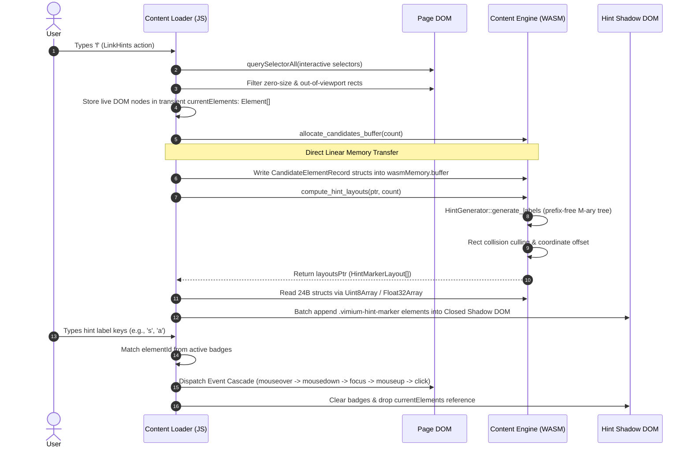
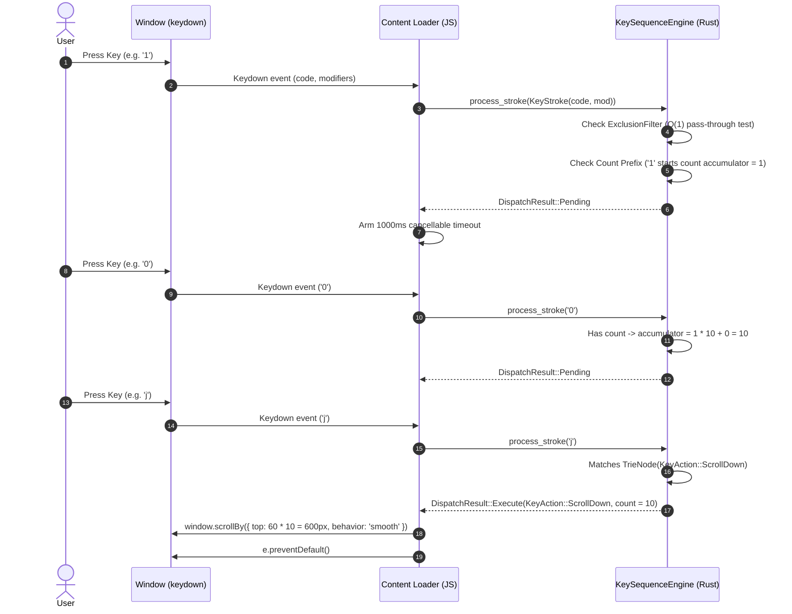
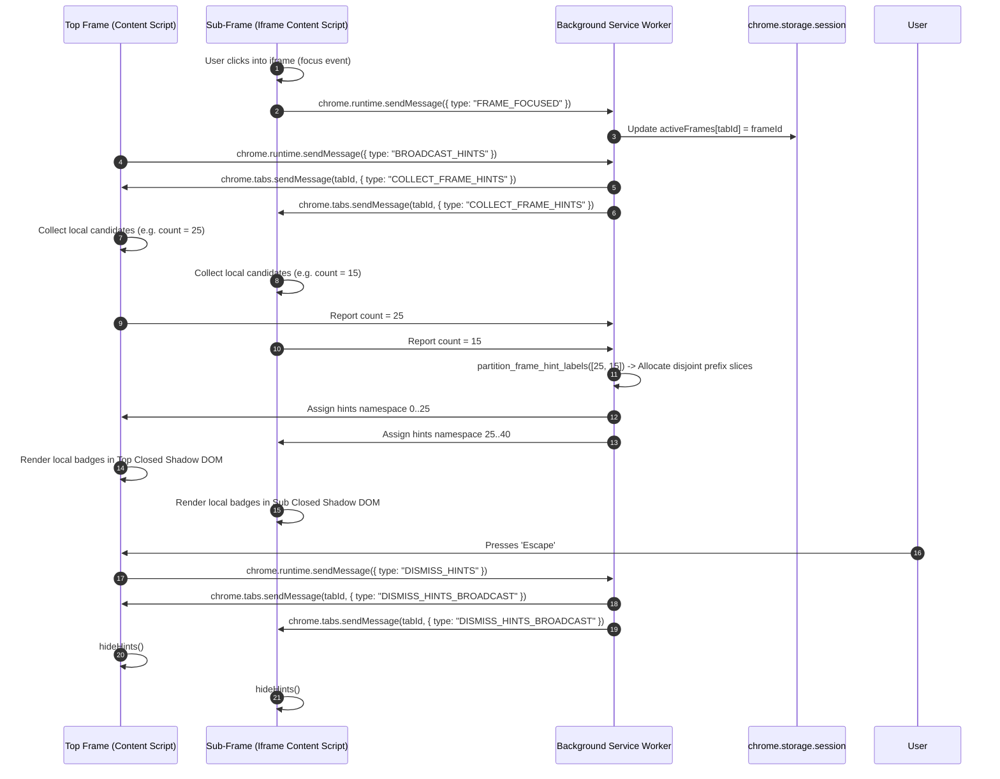

# Phase 1 Core Architecture Specification: Vimium-RS

**Status**: Accepted & Locked  
**Target Browsers**: Google Chrome (Manifest V3), Mozilla Firefox (Manifest V3)  
**Target Environments**: Isolated World Content Script, Stateless Extension Service Worker  
**Primary Language**: Rust 2021 (compiled to `wasm32-unknown-unknown`) + TypeScript/JavaScript Glue  

---

## 1. Executive Overview & Architectural Tenets

**Vimium-RS** is a ground-up rewrite of Vimium C optimized for modern web architectures and browser sandboxes. Phase 1 delivers the foundational keyboard navigation loop: link hinting, key sequence dispatching, scrolling, and multi-frame iframe coordination.

### Architectural Tenets

1. **Zero-Allocation Core on the Hot Path**: All key matching, trie lookups, prefix calculations, and collision culling in `vimium-core` operate without dynamic heap allocation during steady-state input handling.
2. **Hybrid JS/WASM Boundary**: Rather than attempting pure Rust DOM querying via `web-sys` (which incurs 15,000–45,000 costly FFI hops on modern SPAs), JavaScript handles native viewport discovery and Shadow DOM injection, while Rust WASM acts as the pure algorithmic engine. Data crosses the FFI boundary as flat, cache-aligned binary struct arrays mapped directly via `TypedArray` views on WASM linear memory.
3. **Stateless MV3 Lifecycle**: The extension service worker maintains zero in-memory state in WASM, backing all session state (active frame mapping, configuration, exclusion filters) in `chrome.storage.session`.
4. **Isolated World & Closed Shadow DOM**: Content scripts run strictly in the browser extension isolated world (`'wasm-unsafe-eval'`), and hint badges render inside a closed Shadow DOM container (`mode: "closed"`), completely immune to host webpage CSS resets and script tampering.

---

## 2. Crate Topology & Workspace Structure

The project is structured as a Cargo workspace with four distinct crates:

```
vimium-rs/
├── Cargo.toml                  # Workspace definition (resolver = "2", opt-level = "z", LTO enabled)
├── crates/
│   ├── core/                   # Pure Rust algorithmic engine (100% platform-agnostic)
│   ├── content/                # WASM bridge for content scripts (cdylib)
│   ├── background/             # WASM bridge for service worker (cdylib)
│   └── vomnibar/               # Fuzzy search matching engine (cdylib)
├── extension/
│   ├── manifest.json           # Chrome & Firefox Manifest V3 manifest
│   ├── content/
│   │   └── loader.js           # Isolated world loader, DOM bridge, event cascade
│   ├── background/
│   │   └── service_worker.js   # Event-driven service worker & session store
│   └── styles/
│       └── hints.css           # Isolated hint badge styling
└── scripts/
    └── build.sh                # Automated build, test, and wasm packaging pipeline
```

### Module Responsibilities

| Crate | Artifact | Target | Primary Dependencies | Responsibility |
| :--- | :--- | :--- | :--- | :--- |
| `vimium-core` | `rlib` | Any | `smallvec`, `bitflags` | Zero-allocation `KeyTrie`, `HintGenerator` ($M$-ary prefix-free code), `Rect` collision subtraction, `ExclusionFilter`. |
| `vimium-content` | `cdylib` | `wasm32-unknown-unknown` | `vimium-core`, `wasm-bindgen`, `js-sys`, `web-sys` | Exports `init_content_engine`, `allocate_candidates_buffer`, `compute_hint_layouts`, and `process_key_event`. |
| `vimium-background` | `cdylib` | `wasm32-unknown-unknown` | `vimium-core`, `wasm-bindgen`, `js-sys` | Frame prefix partitioning and message type decoding. |
| `vimium-vomnibar` | `cdylib` | `wasm32-unknown-unknown` | `vimium-core`, `wasm-bindgen` | Fuzzy string matching and score ranking (Phase 2). |

---

## 3. Data Contracts & Binary Memory Layouts

To eliminate serialization overhead between JavaScript and WebAssembly, data structures are defined with `#[repr(C)]` and aligned to standard cache-friendly boundaries.

### 3.1. Candidate Element Record (`CandidateElementRecord`)
Transferred from JS DOM Collector into WASM linear memory:

```rust
#[repr(C)]
#[derive(Debug, Clone, Copy, PartialEq)]
pub struct CandidateElementRecord {
    pub element_id: u32,  // 4 bytes: 0-based index into JS transient Element[] array
    pub flags: u32,       // 4 bytes: Bitflags (CLICKABLE, LINK, INPUT, SCROLLABLE, etc.)
    pub x: f32,           // 4 bytes: Client viewport X coordinate (pixels)
    pub y: f32,           // 4 bytes: Client viewport Y coordinate (pixels)
    pub width: f32,       // 4 bytes: Bounding client width (pixels)
    pub height: f32,      // 4 bytes: Bounding client height (pixels)
    pub weight: u16,      // 2 bytes: Element priority score (link vs div)
    pub _pad: u16,        // 2 bytes: Alignment padding to 32 bytes
}
```
*Total Struct Size*: **32 bytes** (exactly two per 64-byte CPU cache line).

### 3.2. Hint Marker Layout (`HintMarkerLayout`)
Emitted by Rust WASM and read directly by JS Shadow DOM Renderer:

```rust
#[repr(C)]
#[derive(Debug, Clone, Copy, PartialEq)]
pub struct HintMarkerLayout {
    pub element_id: u32,  // 4 bytes: Matching element_id
    pub x: f32,           // 4 bytes: Render X position (including scroll offset)
    pub y: f32,           // 4 bytes: Render Y position (including scroll offset)
    pub label_len: u8,    // 1 byte: Length of ASCII hint string (1 to 7)
    pub label: [u8; 7],   // 7 bytes: Inline ASCII characters (e.g., b"SA\0\0\0\0\0")
    pub flags: u32,       // 4 bytes: Presentation flags
}
```
*Total Struct Size*: **24 bytes**.

### 3.3. Packed Keystroke (`KeyStroke`)
Packed representation of user input:

```rust
#[repr(transparent)]
#[derive(Debug, Clone, Copy, PartialEq, Eq, Hash, Default)]
pub struct KeyStroke(pub u16);
// Bits 0..7  : ASCII / Key Code (u8)
// Bits 8..11 : Modifiers (Bit 0: CTRL, Bit 1: ALT, Bit 2: META, Bit 3: SHIFT)
// Bits 12..15: Reserved (0)
```

### 3.4. Pre-computed Exclusion Filter (`ExclusionFilter`)
```rust
#[derive(Debug, Clone, Default)]
pub struct ExclusionFilter {
    pass_ascii: [u64; 4],     // 256-bit set for O(1) passKeys testing
    disabled_entirely: bool,  // Completely bypass extension on matched URL
}
```

---

## 4. System Sequence Workflows

### 4.1. Link Hint Generation & Render Lifecycle



### 4.2. Key Sequence Matching & Count Resolution



### 4.3. Cross-Frame Coordination Handshake



---

## 5. Implementation Roadmap & Quality Gates

### Milestone 1: Core Engine Algorithmic Hardening
- **Deliverables**: Complete default Vim command table in `crates/core`, URL pattern parsing into `ExclusionFilter`, and radix trie collision benchmarks.
- **Verification Gate**: `cargo test -p vimium-core` passes 100% with benchmarks verifying $<100\text{ns}$ key dispatch latency and zero heap allocations during key matching.

### Milestone 2: Content Engine DOM Collector & Shadow DOM Renderer
- **Deliverables**: JIT-optimized TreeWalker collector with viewport culling in `extension/content/loader.js`, multi-line inline link fragment extraction, and closed Shadow DOM badge rendering.
- **Verification Gate**: Verified on top 50 complex web pages (e.g., GitHub, Reddit, Wikipedia, YouTube) achieving $<8\text{ms}$ total hint display time without layout thrashing.

### Milestone 3: Cross-Frame Coordination & Background IPC
- **Deliverables**: Hierarchical frame handshake protocol, `activeFrameId` tracking, and `chrome.storage.session` state synchronization in `extension/background/service_worker.js`.
- **Verification Gate**: Multi-frame test suite verifying collision-free hint keys and synchronous hint dismissal across nested cross-origin iframes.

### Milestone 4: Packaging & End-to-End Browser Integration
- **Deliverables**: Automated release packaging via `./scripts/build.sh`, `.zip` / `.xpi` artifact generation, and manifest validation for Chrome Web Store and Mozilla Add-on store policies.
- **Verification Gate**: Extension loads cleanly in developer mode in Chrome MV3 and Firefox MV3 with zero CSP errors, zero console warnings, and sub-400KB bundle footprint.
